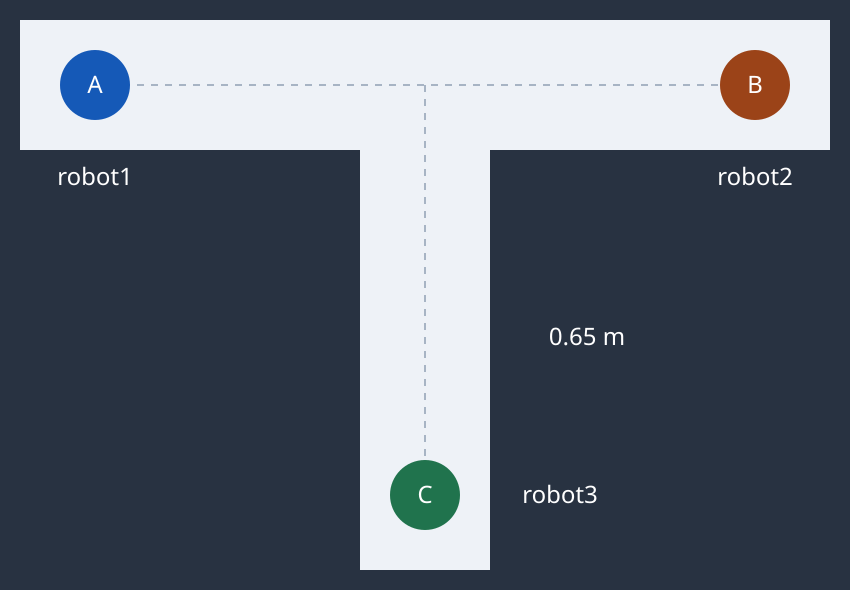

# Mô phỏng MARCO

Chạy bộ lập kế hoạch MARCO của workspace với hai robot ảo. Mỗi batch lấy
pose cuối của đường đi làm pose đầu cho batch tiếp theo. Không cần SSH,
ROS đang chạy hay robot thật. Cách này kiểm tra điều phối và thứ tự nhường
đường, chưa mô phỏng vật lý, Nav2, AMCL hay LiDAR.

Từ thư mục gốc workspace đã build (`bash scripts/build.sh`):

```bash
# Bản đồ phòng, hai goal đã lưu, robot1 ưu tiên
bash sim/run.bash --out /tmp/marco-room.json

# Hai đường cắt nhau trên bản đồ đơn giản
bash sim/run.bash --scenario crossing --out /tmp/marco-crossing.json
```

Kịch bản phòng và chữ T dùng PyYAML và Pillow của Python hệ thống
(`python3-yaml` và `python3-pil` trên Ubuntu). Báo cáo JSON lưu thứ tự
batch, waypoint, task đã hoàn tất và pose cuối. Tiến trình trả mã 1 nếu
MARCO không hoàn tất mission trong giới hạn 32 batch.

## Hoán đổi ba robot trong hành lang chữ T



Map lấy bố cục từ ảnh. File ROS là `maps/t_junction.yaml` và
`maps/t_junction.pgm` trong thư mục `sim/`. Gazebo dựng tường từ lưới này,
MARCO dùng nó để lập đường và RViz hiển thị cùng dữ liệu. A ở đầu trái, B ở đầu phải, C ở cuối nhánh dưới.
Lúc bắt đầu, robot1 ở A, robot2 ở B và robot3 ở C. Mỗi nhánh rộng 0,65 m,
nhỏ hơn tổng đường kính 0,70 m của hai robot. MARCO dùng robot1 làm ưu tiên
khi giải quyết xung đột. Robot đang có ưu tiên vẫn có thể dịch chuyển để
tạo khoảng trống nếu phương án điều phối yêu cầu.

```bash
# Nhập B C A khi terminal hỏi đích cho robot1 robot2 robot3
bash sim/run.bash --scenario t-junction --out /tmp/marco-t.json

# Chạy trực tiếp cùng một kịch bản
bash sim/run.bash --scenario t-junction --swap B C A --out /tmp/marco-t.json
```

Mỗi lệnh bắt đầu lại từ A B C. Nhập đúng ba đích khác nhau, theo thứ tự
robot1, robot2, robot3. Ví dụ `B A C` đổi robot1 với robot2 và giữ C làm
đích cuối của robot3. Các lượt có nhiều robot trong output là các đường
MARCO cho phép chạy chung một batch, có thể ở các nhánh khác nhau.
Với `B A C`, robot1 tiến đến một điểm chờ bên trái ngã ba trong lúc
robot2 rẽ xuống nhánh dưới. Robot1 đi tiếp ở lượt sau khi cả hai đã đến
điểm chờ tương ứng. Bộ lập kế hoạch kiểm tra khoảng cách giữa hai đoạn đường
để cho phép chúng chạy song song dù tốc độ thực tế khác nhau.

## Gazebo headless và RViz

Cần ROS 2 Humble, Ignition Gazebo Fortress và gói TurtleBot4 Simulator.
Nếu simulator nằm trong workspace riêng, đặt `MARCO_TB4_WORKSPACE` trỏ đến
thư mục chứa `environment.sh`. Trên Ubuntu có kho ROS Humble, có thể cài
bằng `sudo apt install ros-humble-turtlebot4-simulator ignition-fortress`.

```bash
bash sim/gazebo.bash
# Mở cả cửa sổ Gazebo và RViz
bash sim/gazebo.bash --gui
# Hoặc bỏ bước hỏi trong terminal
bash sim/gazebo.bash --swap B C A --speed 0.20
```

Gazebo server và RViz chạy đồng thời, trên ROS domain cục bộ 73. Sau khi
nhận odom của cả ba robot, terminal in A/B/C tại pose ban đầu đo được.
Có thể nhập `3` thay cho `C`. RViz hiển thị map, mô hình 3D TurtleBot4 Standard của từng robot,
hướng và đường đang thực hiện. Pose của mô hình cập nhật theo odom mô phỏng. Bộ điều khiển gửi lệnh cho cùng lúc tất cả robot trong
một batch MARCO. Robot nhường đường khi các đường xung đột. Bản tích hợp
này dùng odom mô phỏng và bộ bám waypoint, không dùng Nav2 hay AMCL.
Gazebo và RViz tự thoát khi mission kết thúc. Nhấn Ctrl+C để dừng sớm.
Đường dẫn log được in khi khởi động.

Tốc độ tối đa mặc định của Gazebo là 0,20 m/s. Dùng `--speed 0.05`
để thử cấu hình chậm. Terminal ghi thời gian từng lượt, tốc độ đỉnh theo
odom và sai số vị trí cuối. Thiết lập này chỉ áp dụng cho Gazebo.

## Quét map bằng một robot

Chạy lệnh trong terminal tương tác, sau khi phiên hoán đổi hiện tại kết thúc:

```bash
bash sim/gazebo.bash --mapping --map-out /tmp/t_junction_scan
```

Thêm `--gui` trước `--map-out` nếu muốn mở cả cửa sổ Gazebo. Robot1
khởi tạo ở A. RViz hiển thị robot, scan LiDAR và bản đồ đang được SLAM
Toolbox dựng từ dữ liệu cảm biến. Giữ **W/S** để tiến/lùi, **A/D** để quay.
**Space** dừng, **M** lưu map, **Q** đóng phiên Gazebo và RViz.
`--map-out` là đường dẫn cơ sở của map mới, mặc định lưu vào thư mục log
của phiên để giữ nguyên bản đồ chữ T dùng cho MARCO.
